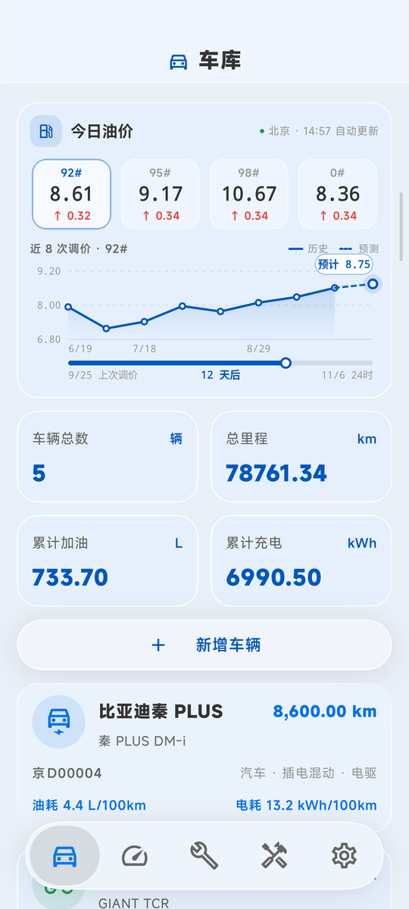
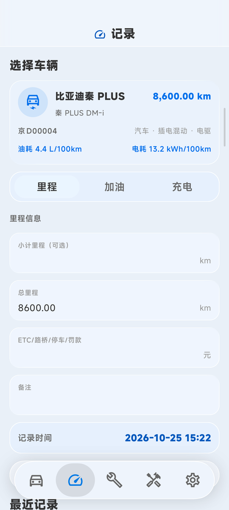
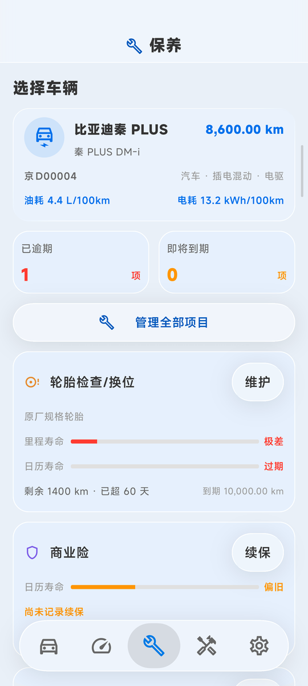
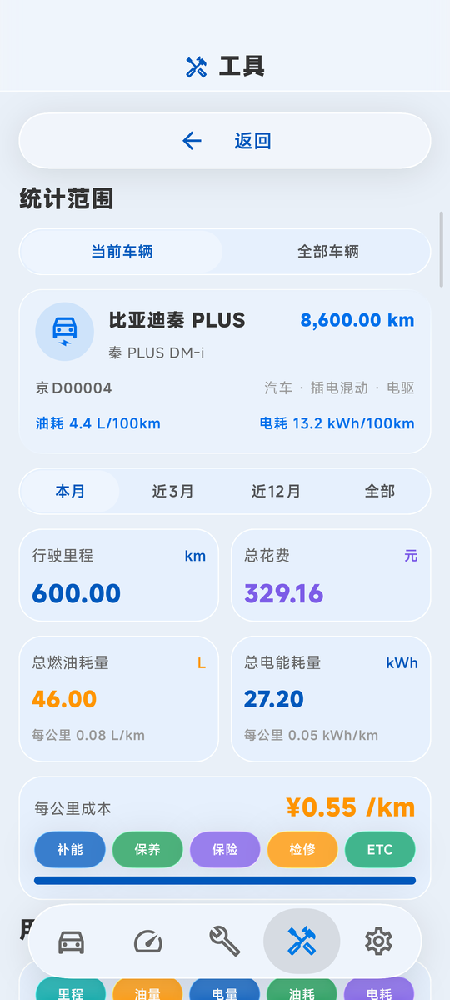
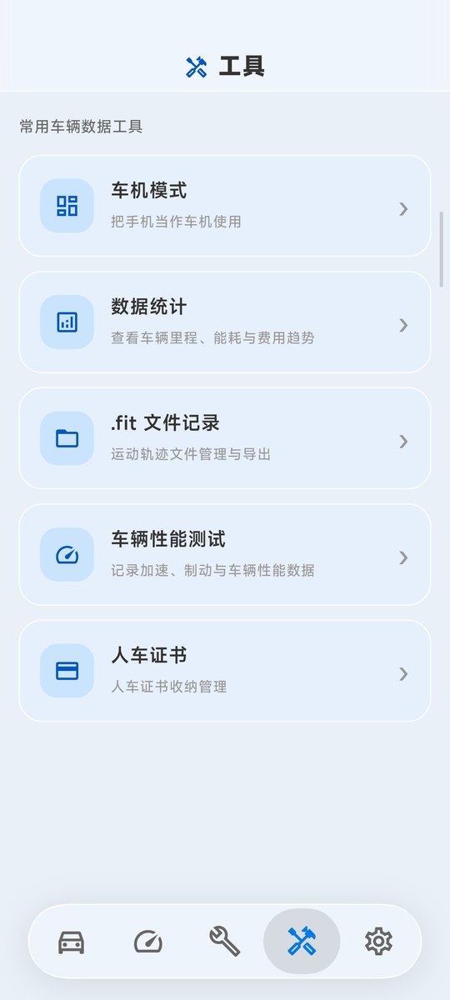
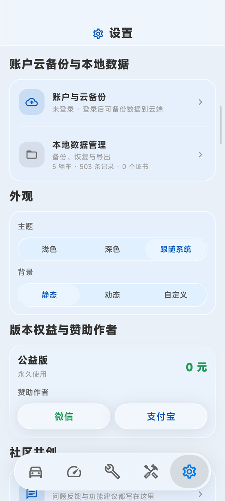
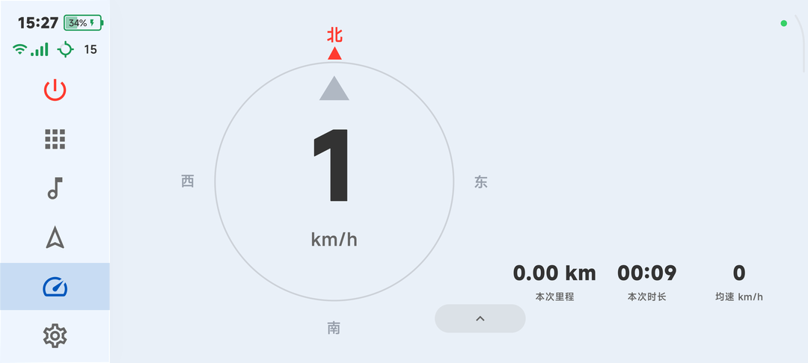
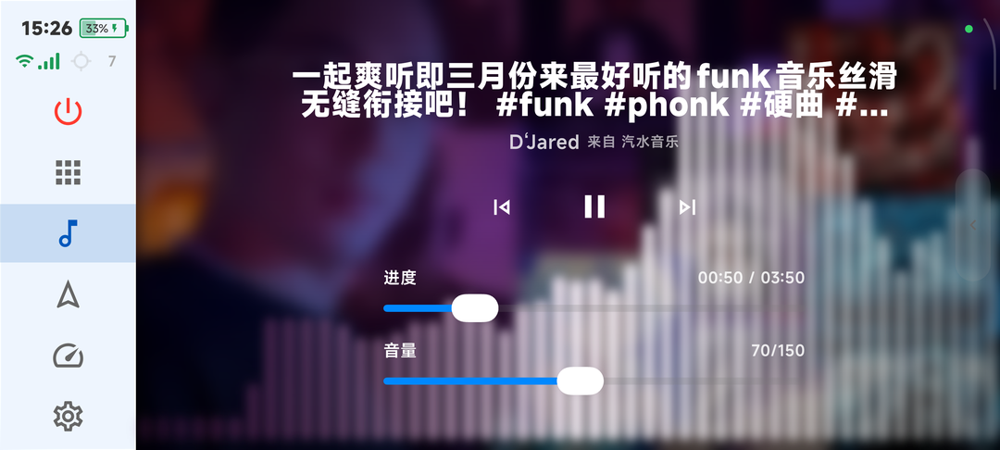
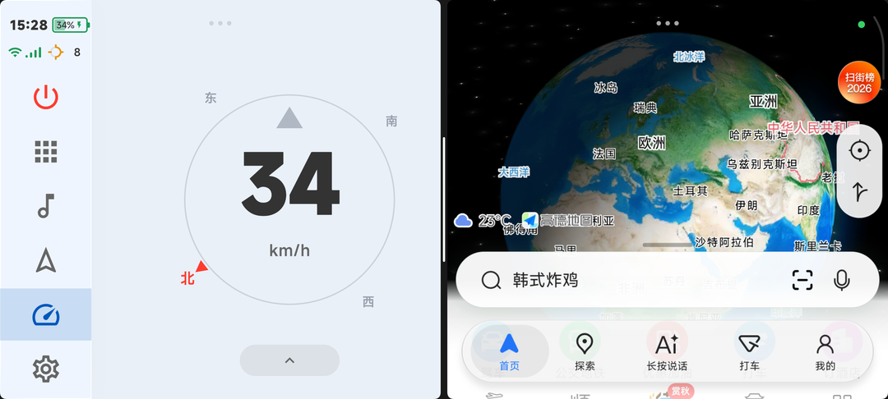
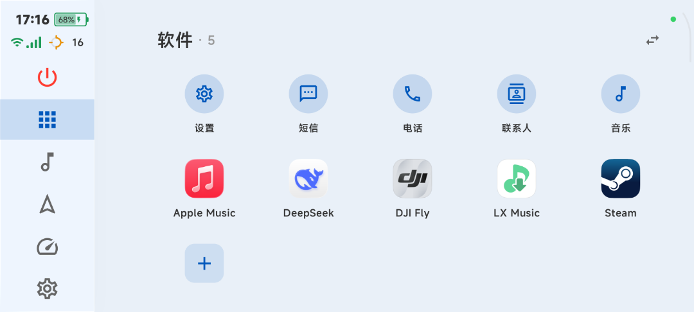

<div align="center">


# 车库 CheKu

**以本地数据为核心的 Android 车辆账本**

车辆档案 · 里程与能耗 · 保养提醒 · 今日油价 · 数据统计 · 车机模式 · FIT 轨迹

[](#构建)
[](https://kotlinlang.org)
[](https://developer.android.com/compose)
[](LICENSE)
[](#-由-ai-构建)
[](#-由-ai-构建)

[🌐 官网与下载](https://www.wangqiyan.top) · [📱 截图](#-截图) · [✨ 功能](#-功能) · [🛠 构建](#-构建) · [🔌 接口说明](docs/API.md)

</div>

---


## 📱 截图

<table>
  <tr>
    <td align="center"><br><sub><b>车库</b> · 今日油价与调价预测</sub></td>
    <td align="center"><br><sub><b>记录</b> · 里程 / 加油 / 充电</sub></td>
    <td align="center"><br><sub><b>保养</b> · 里程与时间双周期</sub></td>
  </tr>
  <tr>
    <td align="center"><br><sub><b>数据统计</b> · 能耗与每公里成本</sub></td>
    <td align="center"><br><sub><b>工具</b> · 车机 / FIT / 性能测试</sub></td>
    <td align="center"><br><sub><b>设置</b> · 外观、备份与云同步</sub></td>
  </tr>
</table>

### 车机模式

<table>
  <tr>
    <td align="center"><br><sub><b>屏显</b> · GPS 车速、指向罗盘、本次行程</sub></td>
    <td align="center"><br><sub><b>音乐</b> · 封面取色、实时音频频谱</sub></td>
  </tr>
  <tr>
    <td align="center"><br><sub><b>分屏</b> · 一边屏显车速，一边导航</sub></td>
    <td align="center"><br><sub><b>应用</b> · 在车机屏上直接拉起手机里的应用</sub></td>
  </tr>
</table>

## ✨ 功能

<table>
  <tr>
    <td width="50%" valign="top">

**🚗 车辆档案**
- 多车管理：燃油车、新能源（纯电 / 混动 / 插混 / 增程）、摩托、电动车、自行车
- 车辆类型与动力类型联动校验，不会出现矛盾组合
- 删除车辆时级联清理里程、能耗、结算与保养数据

**⛽ 里程与能耗**
- 里程、加油、充电三种记录，支持小计里程换算总里程
- 相邻有效记录自动结算百公里油耗 / 电耗与每公里成本
- 处理漏记上一笔、未加满、未充满、里程倒退等边界情况

**🔧 保养管理**
- 按车型生成默认保养模板，里程周期与时间周期同时生效
- 正常 / 即将到期 / 已逾期三档提醒，续保与临时维修记账
- 保养历史可编辑，支持撤销最近一次保养

    </td>
    <td width="50%" valign="top">

**📈 今日油价与统计**
- 按地区获取油价，展示近 8 次调价走势与下次调价预测
- 按月 / 近 3 月 / 近 12 月 / 全部统计里程、花费与能耗

**🖥 车机模式**
- 把手机当车机：屏显车速、罗盘、行程，音乐面板与实时频谱
- 悬浮 dock、分屏启动导航与音乐，横竖屏自适应

**🛰 FIT 轨迹与性能测试**
- 行驶轨迹记录为标准 `.fit` 文件，可导出到运动平台
- 加速、制动等性能测试，按 GNSS 精度标记数据质量

**🔐 数据与备份**
- 数据默认只存在本机；`.che` 备份包先压缩再 AES-GCM 加密
- 人车证书收纳；可选的账户与云备份（需自建服务端）

    </td>
  </tr>
</table>

## 🧊 液态玻璃 UI

界面采用液态玻璃（Liquid Glass）风格：底部 dock 的水滴选中态、玻璃卡片的折射与高光、滑块与开关的弹性形变。

玻璃效果基于 **[Kyant0/AndroidLiquidGlass](https://github.com/Kyant0/AndroidLiquidGlass)**（Apache License 2.0）：

- 以依赖形式使用其发布的 `io.github.kyant0:backdrop` 与 `io.github.kyant0:shapes` 库；
- `glassui` 模块中的组件（`LiquidBottomTabs`、`LiquidSlider`、`LiquidToggle`、`LiquidButton` 等），以及 `app/.../glass/internal`、`glass/motion/DampedDragAnimation.kt`，派生自该项目的示例与源码，并按本项目需要做了修改，文件头均保留了来源声明。

感谢 Kyant0 的出色工作。详见 [NOTICE](NOTICE)。

## 🛠 构建

**环境要求**：JDK 17、Android SDK（compileSdk 37 / Build Tools 37.0.0）

```bash
git clone https://github.com/NICEGSP/cheku-android.git
cd cheku-android
./gradlew assembleDebug        # Windows 用 gradlew.bat
```

产物位于 `app/build/outputs/apk/`。运行单元测试：`./gradlew testDebugUnitTest`。

### 服务端配置（可选）

仓库里不包含任何服务器地址。不做任何配置时，App 以纯本地模式运行，账户、云备份、在线更新、联网油价等功能自动关闭，其余功能不受影响。

如需对接自己的服务端，在 `local.properties`（不入库）或 `~/.gradle/gradle.properties` 中添加：

```properties
# 官网根地址，必须是 HTTPS
CHEKU_WEBSITE_URL=https://www.example.com
# 运行时配置的签名公钥（ECDSA P-256，SPKI DER 的 base64）
CHEKU_CONFIG_PUBLIC_KEY=MFkwEwYHKoZIzj0CAQYIKoZIzj0DAQcDQgAE...
# 可选：证书公钥锁定，SPKI SHA-256 的 base64，逗号分隔
CHEKU_CERT_PINS=AAAA...=,BBBB...=
```

服务端需要实现的接口与数据格式见 **[docs/API.md](docs/API.md)**。

### 发布签名（可选）

在 `secrets/keystore.properties`（已被 `.gitignore` 忽略）中写入：

```properties
storeFile=../secrets/release.jks
storePassword=...
keyAlias=...
keyPassword=...
```

存在该文件时 debug 与 release 都用它签名；否则 debug 使用默认调试证书，release 输出未签名包。

## 🧱 技术栈

| 类别 | 选型 |
| --- | --- |
| 语言 / 构建 | Kotlin 2.4、AGP 9.3、KSP、Java 17、core library desugaring |
| UI | Jetpack Compose、Material 3、液态玻璃（backdrop / shapes） |
| 数据 | Room（SQLite）、SharedPreferences、Android Keystore |
| 异步 | Kotlin Coroutines / Flow |
| 其他 | Shizuku（音频频谱捕获）、jxl（导入小熊油耗表格） |
| 测试 | JUnit 4、kotlinx-coroutines-test、Compose UI Test |

最低支持 Android 6.0（API 23），目标 API 37。

## 📂 项目结构

```text
cheku-android
├── app/                         Android 应用
│   └── src/main/java/com/cheku/app
│       ├── MainActivity.kt      Compose 页面与交互
│       ├── LedgerViewModel.kt   UI 状态与业务入口
│       ├── data/                Room 实体、DAO、仓库
│       ├── domain/              能耗结算、保养规则
│       ├── carmode/             车机模式
│       ├── fit/  performance/   FIT 轨迹与性能测试
│       ├── glass/               玻璃组件层
│       ├── config/  net/        服务端配置、运行时配置校验、证书锁定
│       └── ...Service.kt        账户、云备份、更新、油价、反馈客户端
├── glassui/                     液态玻璃组件库（Kotlin Multiplatform 模块）
└── docs/
    ├── API.md                   App ↔ 服务端接口格式
    └── screenshots/             截图
```

## 📄 开源协议

本项目以 [Apache License 2.0](LICENSE) 开源。派生自 Kyant0/AndroidLiquidGlass 的部分同样遵循 Apache License 2.0，见 [NOTICE](NOTICE)。

## 🤖 由 AI 构建

> [!NOTE]
> **本项目 100% 由以下模型在 Vibe Coding（氛围编程）环境下使用自然语言构建，人类手写代码行数：0 行。**

| 模型 | 贡献占比 |
| --- | --- |
| deepseek-v4.1-flash | `████████████████████` 40% |
| claude-opus-5-5 | `█████` 10% |
| deepseek-v4-flash | `█████` 10% |
| gpt-5.5 | `█████` 10% |
| gpt-5.6sol | `█████` 10% |
| gpt-6.1sol | `█████` 10% |
| glm5.3-flash | `█████` 10% |

从需求、界面、算法到测试，全部通过与模型对话完成，没有一行代码是手写的。

<div align="center">
<sub>🌐 <a href="https://www.wangqiyan.top">www.wangqiyan.top</a></sub>
</div>
